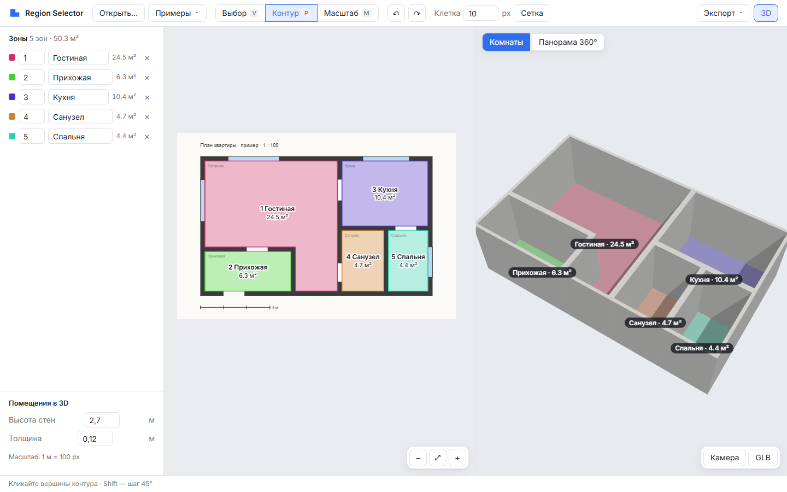
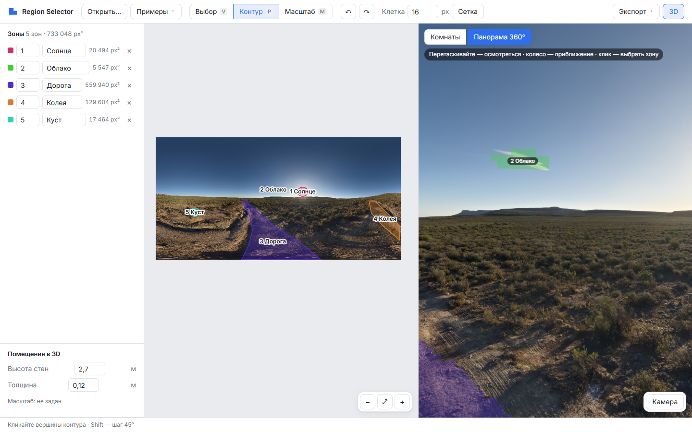

<h1 align="center">Region Selector 3D</h1>

<p align="center">
  Разметка зон на планах и 360° панорамах · генерация 3D-помещений по плану · просмотр панорамы с зонами
</p>

<p align="center">
  <a href="https://s-afanasiev.github.io/region-selector-3d/"><b>Демо: план → 3D</b></a>
  &nbsp;·&nbsp;
  <a href="https://s-afanasiev.github.io/region-selector-3d/?sample=panorama"><b>Демо: панорама 360°</b></a>
  <br>
  <sub>открывается в браузере, установка не нужна</sub>
</p>

<p align="center">
  <a href="https://github.com/s-afanasiev/region-selector-3d/actions/workflows/pages.yml"></a>
</p>


<p align="center"><sub>Обводите комнаты на плане — пол и стены строятся сразу, площади считаются в м²</sub></p>


<p align="center"><sub>Зоны поверх 360° панорамы — ровно так, как их проверит плеер виртуального тура</sub></p>

## Возможности

- **Разметка зон.** Контур обводится по вершинам; Shift даёт шаг 45°, линейка показывает длину отрезка в метрах. Зона не может пересечь себя или наложиться на соседнюю — редактор отказывает и называет причину. Отмена и повтор любой правки.
- **План → 3D.** Масштаб задаётся по отрезку известной длины. Каждая зона с контуром становится комнатой: пол, стены заданной высоты и толщины, подпись с площадью. Модель перестраивается на каждую правку, клик по комнате в 3D выбирает её на плане.
- **Панорама 360°.** Изображение натягивается на сферу, зоны — полупрозрачным слоем поверх. Наведение подсвечивает зону, клик выбирает, выбор в списке плавно поворачивает камеру к зоне.
- **Экспорт.** Разметка в JSON и в формат плеера тура `arr_*.js`, картинка с разметкой в PNG, 3D-модель в GLB для Blender.

## Как устроено

- **Своя геометрия, без библиотек** — [src/geometry](src/geometry): площадь и ориентация контура, проверка самопересечения, триангуляция отсечением ушей, смещение контура со стыками miter. Триангуляция проверена на 500 случайных многоугольниках: сумма площадей треугольников равна площади контура.
- **Пол и стены — собственная `BufferGeometry`** ([room-mesh.js](src/geometry/room-mesh.js)). Порядок обхода выбран так, что нормали пола смотрят вверх, внутренние грани стен — в комнату, внешние — наружу; это проверяет тест, а не `side: DoubleSide`.
- **Панорама без пересечения со сферой** ([equirect.js](src/geometry/equirect.js)). Пиксель `(x, y)` → долгота `φ = 2π·x/W` и угол от зенита `θ = π·y/H` → направление. Камера стоит в центре сферы, поэтому луч из камеры — уже направление: из него сразу получаются пиксель, клетка и номер зоны. Формулы сверены тестом с UV-развёрткой `THREE.SphereGeometry` и с направлением взгляда камеры three.js.
- **Модель зон с инвариантами** ([zone-map.js](src/zones/zone-map.js)). Одна клетка — не больше одной зоны; каждая правка либо применяется целиком, либо возвращает отказ `{ ok: false, code, detail }` и ничего не меняет.
- **Рендер по требованию.** Кадр рисуется только когда что-то изменилось — открытая вкладка не греет видеокарту.
- **CI.** Каждый push в `main`: 34 теста → сборка → публикация на GitHub Pages. Упавший тест останавливает публикацию.

**Стек:** three.js r186 · Vite · ES-модули без фреймворков · `node:test` · GitHub Actions + Pages.

## Архитектура

Точка сборки — [src/main.js](src/main.js): по ней видно всё дерево и все числа поведения.

```
Project(ZoneMap(Grid), History)        подложка, масштаб, зоны; правки — через историю
  Selection                             выбранная и подсвеченная зона, общая для всех видов
  ZoneRaster                            картинка «клетка = пиксель», общая для плана и панорамы
  Viewport(PlanPainter, Tools)          2D: выбор, контур, масштаб
  RoomsView(Scene3D, RoomModel)         3D-комнаты, перестраиваются на каждое изменение зон
  PanoramaView                          360°: сфера с изображением и слоем зон
  ZoneList, StatusBar                   панели
Commands                                действия пользователя → сценарии, итог — в строку состояния
```

## Управление

| Действие | Как |
|---|---|
| Открыть план, панораму или разметку | «Открыть…» или перетащить файл в окно |
| Обвести зону | **P**, клики по вершинам; **Shift** — шаг 45°; замкнуть — Enter, правый клик или клик в первую точку; **Backspace** — убрать точку, **Esc** — отменить |
| Задать масштаб | **M**, два клика по отрезку известной длины и длина в метрах |
| Выбрать, удалить | **V**, клик по зоне на плане, в списке или в 3D; **Delete** |
| Отменить / повторить | **Ctrl+Z** / **Ctrl+Y** |
| Навигация по плану | колесо — масштаб к курсору, средняя кнопка или **Space** + перетаскивание — сдвиг, **F** — вписать |
| 3D-вид | «Комнаты» или «Панорама 360°»; при открытии выбирается сам: задан масштаб — план, пропорции 2:1 — панорама |

## Запуск локально

```bash
npm install
npm run dev     # http://127.0.0.1:5173
npm test        # 34 теста геометрии и модели, без браузера
npm run build   # статическая сборка в dist/
```

## Дальше

- проёмы дверей и окон в стенах;
- общая стена у соседних комнат вместо двух половин;
- перетаскивание вершин готового контура;
- рисование зон прямо на сфере панорамы, включая контур через шов `x = 0 / W`.

---

<sub>Пример панорамы — [Poly Haven](https://polyhaven.com), CC0. Примеры собираются скриптами: [план](scripts/make-sample-plan.js), [зоны на панораме](scripts/make-sample-panorama.js).</sub>
